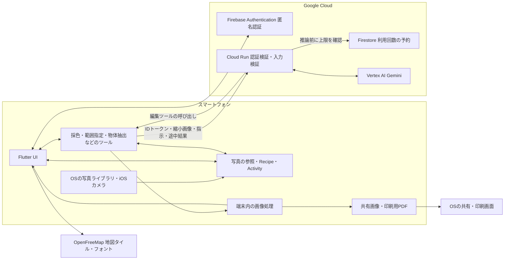

# 技術構成

After Hueは、写真の解釈と編集の判断にGoogle CloudのGeminiを使い、実際の画素処理は端末で行います。AIと人が同じ編集設定を操作するため、自動処理の結果を後から手動で調整できます。

Google Cloudプロジェクトは `after-hue-pdhaku0`、Cloud Runの配置先は `asia-northeast1` です。[AIサービス](https://after-hue-ai-675070172838.asia-northeast1.run.app/health)は配置済みで、ヘルスチェックの200応答、Firebase匿名認証の通過、未認証リクエストの401拒否、Vertex AIによる写真の選別を実接続で確認しました。続いて、途中画像を二度確認する現像、追加の編集依頼、端末側の描画まで完走しました。これは一枚の写真でのクラウド経路の確認であり、実機UIでの保存操作や全端末の品質を保証するものではありません。[確認記録](verification.md)に操作の流れを残しています。

## Google Cloudに置く処理と、その理由

Cloud Runは、アプリから届くAIリクエストを受け、FirebaseのIDトークン、入力形式、利用量を確認してVertex AIへ渡します。AIモデルの認証情報を端末に配布せず、利用制限をサービス側で管理するために置いています。アプリの画面や写真ライブラリをWebサーバーへ移す構成ではありません。

Firebase Authenticationは、氏名やメールアドレスの登録を求めず、利用者を継続して識別するために使います。再認証用トークンは端末の安全なストレージに保存します。公開接続情報だけでAIを直接呼べるわけではなく、Cloud Run側がトークンの署名・発行元・有効期限を検証します。

Firestoreは、AIの利用回数を保存します。サービス全体と利用者ごとの回数を同じトランザクションで予約してから、有料の推論を開始します。Cloud Runの再起動や複数インスタンスによって上限がリセットされないための選択です。写真や入力した文章を保存する用途ではありません。クライアントからの直接アクセスは拒否し、実接続で403を確認しています。

Vertex AIでは、現像と編集の修正にGemini 3.8 Flash、写真の選別にGemini 3.5 Flash-Liteを設定しています。写真を見て対象を理解する判断と、色を測る・範囲を指定する・途中結果を見るというツール操作を組み合わせます。選別と編集で必要な処理が異なるため、モデルを分けています。

現在の運用設定は、UTCの日付ごとにサービス全体1,000回、利用者ごと300回のAPI呼び出し上限です。一枚の写真で複数回呼び出すため、写真枚数ではありません。失敗・キャンセルされた推論も予約済み回数に含めます。予算通知は3,000円で設定していますが、通知は請求額を強制的に止める仕組みではありません。実行用サービスアカウントの権限はVertex AIとDatastoreの利用に絞っています。

確認先: [AIクライアント](../../lib/agent/gemini_agent.dart)、[匿名認証](../../lib/agent/cloud_auth.dart)、[サーバーの認証](../../server/ai/src/auth.js)、[利用回数](../../server/ai/src/quota.js)、[Vertex AI接続](../../server/ai/src/vertex.js)、[運用手順](../../server/ai/README.md)。

## 端末内に置く処理

写真の参照、撮影日時と位置情報、編集設定、Activityは端末に保存します。原本の変更に備えたスナップショットも端末内に作成します。編集結果でOSの写真ライブラリの原本を上書きしません。

色の比較にはOKLab/OKLChを使います。残す色・除外色・対象範囲・境界の調整から、各画素をどの程度カラーで残すかを計算します。Crop、回転、彩度も同じ編集データに含みます。写真の高解像度描画、サムネイルと色テクスチャのキャッシュ、重複判定、原本変更の比較は、クラウドAIを呼ばずに行います。

AIは、採色、色の分布の確認、色と範囲の設定、物体抽出、描画結果の確認をツールとして呼び出します。ツールの実行は端末側です。画像を自由に描き直す生成ではなく、人も操作できるRecipeを更新します。iOSの物体抽出は利用できる環境で呼び出し、Androidでは未対応です。

確認先: [描画](../../lib/core/renderer.dart)、[編集データ](../../lib/core/recipe.dart)、[編集ツールの仕様](../../lib/agent/editing_contract.dart)、[保存とキュー](../../lib/data/store.dart)、[原本比較](../../lib/core/source_tracking.dart)、[色テクスチャのキャッシュ](../../lib/data/photo_patch_cache.dart)。

## データの送信と途中の操作

クラウドAIへの送信は利用者の同意後に行います。送信する画像は端末内でピクセルから作り直した縮小画像で、元写真のGPSやEXIFを付けません。ただし、写真の見た目や入力文には個人情報が含まれる可能性があります。AI中継サーバーは画像・指示・応答をアプリ用データベースやアプリログへ保存しません。認証、利用量、接続ログ、Google側の保持は別に存在します。詳しくは[プライバシーの説明](../privacy.md)をご覧ください。

写真は上限のあるキューで処理します。削除やクラウドAIの同意撤回では処理を中止し、待機・実行・完了を区別します。Askの途中で編集画面を閉じた場合は処理を続け、Activityから結果へ戻れます。通信の中止は、外部サービスがすでに行った推論や料金を取り消す保証ではありません。

確認先: [同意のテスト](../../test/cloud_ai_consent_test.dart)、[認証のテスト](../../test/cloud_auth_test.dart)、[Geminiのテスト](../../test/gemini_agent_test.dart)、[サーバーのテスト](../../server/ai/test/)、[画面を離れる編集](../../test/background_activity_test.dart)。自動テストには代替応答を用いるものがあり、ライブ接続の検証とは区別します。

## 今回含めない機能

Exploreの投稿・閲覧機能は延期しました。試作コードは別ブランチ `feature/explore-gcp` に保全し、この提出版の機能やGoogle技術の活用実績には含めません。Cloud StorageやCloud Vision SafeSearchを、現在稼働する編集エージェントの構成図へ混ぜていません。
