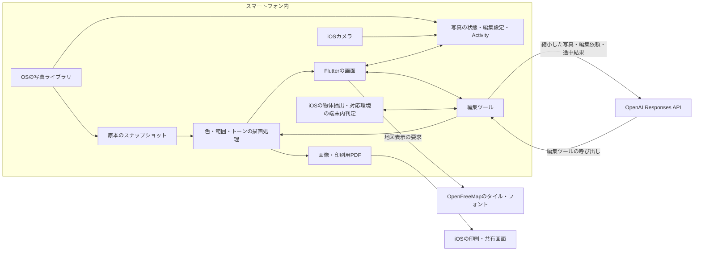
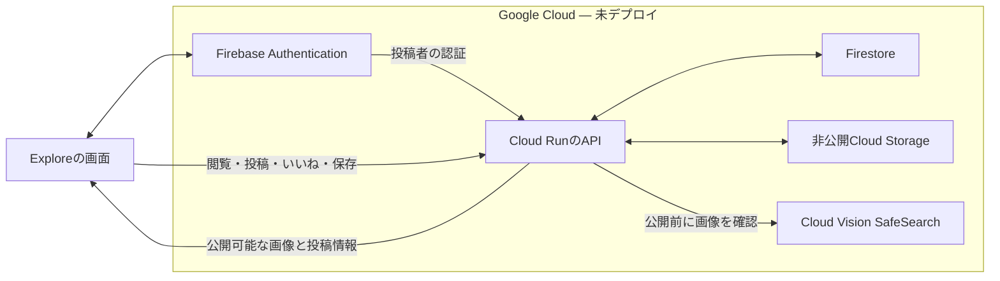

# 技術構成

After Hueでは、写真の読み込み、編集設定、画像の描画、ギャラリーの状態を端末内で扱います。クラウドAIは編集設定を決める役割を持ち、画素を描画する処理と分けています。これにより、AIが決めた結果を手動編集で引き継げます。

次の図は、2026年11月10日時点の実装です。Google Cloud上に稼働している構成図ではありません。

## 端末内に置く処理

写真の参照、撮影日時と位置情報、編集設定、作業の履歴は端末内に保存します。原本の変更に備えたスナップショットも端末内に作成します。アプリはOSの写真ライブラリ内の原本を編集結果で上書きしません。

色を比較する処理はOKLab/OKLChを使い、残す色と除外する色、対象範囲、境界の調整から各画素をどの程度カラーとして残すかを計算します。Cropと回転、彩度の調整も編集設定の一部です。プレビューと書き出しが同じ設定を使うことを、テストで確認しています。

サムネイルと色のテクスチャはキャッシュを利用します。写真の読み込みや重い描画をUIの更新から分け、ギャラリーの表示を待たせにくくする構成です。

確認先: [描画](../../lib/core/renderer.dart)、[編集データ](../../lib/core/recipe.dart)、[保存とキュー](../../lib/data/store.dart)、[原本比較](../../lib/core/source_tracking.dart)、[色のテクスチャキャッシュ](../../lib/data/photo_patch_cache.dart)。

## クラウドAIとのやり取り

APIキーが設定されている場合、現在はOpenAI Responses APIを利用します。キーがない場合は、端末内の簡易Autoに切り替わります。自然言語のAskにはクラウドAIが必要です。

AIは色の採取、色相分布の確認、残す色・除外色の設定、対象の抽出、範囲の調整、彩度・Cropの設定、描画結果の確認といったツールを呼び出します。手動編集と同じRecipeを更新し、端末内で描画した途中結果とマスクを見て調整します。

APIへ渡す画像は端末内でピクセルから作った縮小画像です。撮影日時やGPSのメタデータをリクエストの項目として渡す実装にはしていません。ただし、写真の見た目やユーザーが入力する文章に、場所や個人に関する情報が写り込む可能性はあります。端末外へ何も出ないアプリではありません。

確認先: [AIへのリクエストとツール](../../lib/agent/openai_agent.dart)、[共通編集セッション](../../lib/agent/agent.dart)、[写真の読み込み](../../lib/data/photo_source.dart)。

## 実行中の操作

複数の写真は上限のあるキューで処理します。削除やユーザーによる引き継ぎでは処理を中止し、完了済み・待機中・実行中を区別します。Askの処理を続けたまま編集画面を閉じる場合は、完了結果を保存し、Activityからその写真へ戻れるようにしています。

確認先: [Activity](../../lib/data/activity.dart)、[キャンセルのテスト](../../test/agent_cancellation_test.dart)、[画面を離れる場合のテスト](../../test/background_activity_test.dart)。

## ExploreのGCP構成 — 実装中・未デプロイ

Exploreは、他の人が公開した写真を閲覧し、自分の写真も投稿できる機能として、別ブランチ `feature/explore-gcp` で開発しています。既存の写真編集と分け、完成度を確認してから採用を判断するためです。編集エージェントをGoogle Cloudへ移す作業は行っていません。

GCPプロジェクト `after-hue-pdhaku0`（プロジェクト番号 `675070172838`）は作成済みです。現在は課金アカウントの紐付けが上限によりできておらず、以下のサービスはまだ稼働していません。バックエンドのコードとローカルテストがあることと、クラウドで利用できることを分けて記載します。

Cloud Runは、投稿・閲覧・削除などのAPIをまとめ、認証と公開前の確認をサーバー側で行う役割です。Firestoreには投稿の状態や反応を保存し、画像と色バッジのテクスチャは非公開のCloud Storageに置きます。画像はAPIを経由して配信し、未公開・削除済みの投稿を返さない設計です。

Firebase Authenticationのアカウントは内部で投稿者を識別するために使います。投稿を見た人へは、作者のアカウント名やIDを返しません。これにより、写真を見せる画面は匿名のまま、本人が自分の投稿を確認・削除できます。認証状態を失った場合の復旧方法は、一般公開前に整える必要があります。

Cloud Vision SafeSearchは、投稿画像と色バッジを公開前に確認するために使います。確認に失敗した画像は公開しない実装です。ただし、著作権の確認や、すべての不適切な投稿を判定する仕組みではありません。通報対応、異議申立て、運営画面などは未実装です。

コードはExploreブランチの `server/`、通信仕様は同ブランチの `docs/design/explore-api.md` にあります。ローカルテストでは、投稿と削除、所有者の確認、公開情報からのID除外、再送、反応の同時更新、確認処理の失敗、画像メタデータの除去を扱っています。クラウドの権限・インデックス・認証設定・実際のAPI接続は、デプロイ後の確認が必要です。

提出用の図へ切り替える前に、稼働URL、リージョン、課金・予算設定、アプリからの一連の操作を確認します。まだ作成していないURLや、未稼働のサービスを成果として記載しません。
