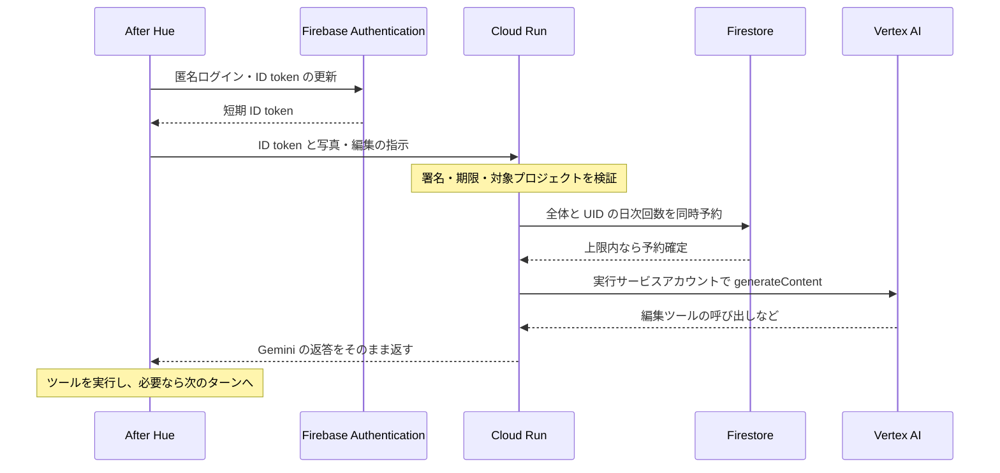

# After Hue のクラウド AI

このサービスは、写真を取り込むか判断する処理と、写真の編集方針を決めるエージェントを Vertex AI に接続します。アプリから写真、指示、会話履歴を受け取り、Gemini の返答を返します。マスク作成、物体抽出、描画などの編集ツールは引き続きアプリで実行します。OpenAI に通信する処理はありません。

Explore の投稿サーバーとは別のサービスです。このディレクトリだけを Cloud Run にデプロイします。

## 接続仕様

`GET /health` は `{"ok":true}` を返します。これはプロセスが応答できることの確認で、Vertex AI や Firestore の権限・利用可否を保証するものではありません。Cloud Run は末尾が `z` の一部のパスを予約しているため、`/healthz` は使いません（[公式の既知の問題](https://docs.cloud.google.com/run/docs/known-issues#reserved-url-paths)）。

`POST /v1/generate` に、Firebase Authentication の ID token を `Authorization: Bearer …` で送ります。アプリは初回に匿名アカウントを作り、そのアカウントの短期トークンを取得します。共有の AI キーはアプリに配りません。本文は次の形式です。

```json
{
  "purpose": "develop",
  "systemInstruction": {"parts": [{"text": "Help edit the photo."}]},
  "contents": [{"role": "user", "parts": [{"text": "Keep the pink flowers."}]}],
  "tools": [{"functionDeclarations": [{
    "name": "render",
    "description": "Render the current edit in the app.",
    "parametersJsonSchema": {"type": "object", "properties": {}}
  }]}],
  "generationConfig": {"maxOutputTokens": 8192}
}
```

`purpose` は `judge` または `develop` です。`contents` は必須で、その他の項目は省略できます。画像は独立した part の `inlineData: {mimeType, data}` で渡します。JPEG、PNG、WebP に対応します。`functionResponse.parts` は使えません。ツールの結果は JSON にし、画像は別の inline part に置きます。

成功時は Gemini の generateContent 応答 JSON をそのまま返します。次のツール呼び出しへ進むときは、`candidates[].content` 全体を履歴へ戻してください。`thoughtSignature` を含む parts をテキストだけに作り直すと、署名を失います。このサーバーは検証済みの contents、function call/response、function declaration をそのまま転送します。

アプリが指定できるのは編集の内容です。モデル、Google Cloud プロジェクト、外部の接続先は指定できません。外部ファイルの取得、Google Search、コード実行などの組み込みツールには対応せず、アプリ自身が実行する function declarations に限定しています。

失敗時は `{"error":{"code":"…","message":"…"}}` を返します。認証不備は 401、入力不備は 400、容量超過は 413、混雑・頻度制限は 429、AI のタイムアウトは 504、それ以外の接続障害は原則 503 です。Google の内部エラーメッセージや認証情報は返しません。

## 認証と利用上限

Firebase Admin SDK がトークンの署名、有効期限、発行元、対象プロジェクトを確認します。サーバーの `GOOGLE_CLOUD_PROJECT` と違うプロジェクトのトークンは使えません。毎ターンのユーザー照会を避けるため `checkRevoked=false` を使い、失効やアカウント無効化の即時確認は行いません。発行済み ID token は通常の有効期限である最長約 1 時間まで使える場合があります。

匿名アカウントは誰でも作れるため、匿名認証だけで不正利用を防げるわけではありません。UID 単位の制限を新しいアカウントで回避されても、Firestore に保存するサービス全体の日次上限と出力上限が残ります。App Check による正規アプリの検証は未実装です。Firebase の Web API key は認証サービスを指定する公開設定であり、AI の利用料金を直接支払う秘密のキーではありません。

| 項目 | 上限 |
| --- | --- |
| HTTP JSON 本文 | 16 MiB |
| 画像 | 12 枚、1 枚 4 MiB、合計 10 MiB |
| 画像データ以外の指示・履歴・ツール定義 | 合計 512 KiB |
| 会話 | 128 ターン、合計 512 parts |
| function declarations | 64 個 |
| 出力候補 | 1 個 |
| 最大出力トークン | judge は 2,048、develop は 8,192 |
| IP ごとのリクエスト数 | 1 分間に 180 回 |
| UID ごとのリクエスト数 | 1 分間に 120 回 |
| サービス全体のリクエスト数 | 1 分間に 240 回 |
| 同時実行 | IP ごとに 6、UID ごとに 4、サービス全体で 8 |
| サービス全体の日次上限 | 既定 1,000 回、Firestore に保存 |
| UID ごとの日次上限 | 既定 300 回、Firestore に保存 |
| 上流応答の最大サイズ | 4 MiB |
| タイムアウト | 既定 90 秒、設定可能範囲 1〜120 秒 |

日次上限は UTC の日付で区切り、Vertex AI を呼び出す前に Firestore のトランザクションで全体と UID の両方を予約します。別のインスタンスから同時に処理しても、サーバーが再起動しても、保存済みの回数は引き継ぎます。予約後にエラーや中断が起きても回数は戻しません。Firestore が利用できない場合も、上限を確認せず AI を呼び出すことはありません。

分単位の頻度と同時実行のカウンターはプロセス内です。下記のデプロイ例では最大インスタンス数を 1 にします。この短時間の制限はインスタンスの切り替えでリセットされますが、Firestore に保存した日次上限は残ります。リクエスト数の上限は料金の上限とは異なるため、予算アラートと Vertex AI 側のクォータも設定してください。

アプリが通信を切断すると、サーバーは AbortController で上流の通信を中断し、同時実行枠を解放します。すでに Google 側で始まった計算や課金まで取り消せるという保証ではありません。

## モデルと環境変数

モデルはサーバー側で決めます。2026 年 11 月 10 日に確認した Google の公式モデル一覧では、Gemini 2.5 Flash は 10 月 20 日に提供終了とされています。そのため既定値を現行 GA の `gemini-3.8-flash` と `gemini-3.5-flash-lite` にしました。旧モデル ID も管理者向けの許可リストには残していますが、利用できるとは限りません。デプロイするプロジェクトで実際に呼び出して確認してください。

| 変数 | 内容 |
| --- | --- |
| `GOOGLE_CLOUD_PROJECT` | 必須。今回のプロジェクトは `after-hue-pdhaku0` |
| `VERTEX_LOCATION` | 既定 `global`。他に `asia-northeast1`、`us-central1` を許可。モデルの地域対応は別途確認 |
| `VERTEX_DEVELOP_MODEL` | 既定 `gemini-3.8-flash` |
| `VERTEX_JUDGE_MODEL` | 既定 `gemini-3.5-flash-lite` |
| `AI_TIMEOUT_MS` | 既定 `90000` |
| `AI_DAILY_REQUEST_LIMIT` | サービス全体の UTC 日次上限。既定 `1000` |
| `AI_USER_DAILY_REQUEST_LIMIT` | UID ごとの UTC 日次上限。既定 `300` |
| `PORT` | Cloud Run が設定。ローカルの既定は `8080` |

Google への接続は Application Default Credentials を使います。Cloud Run の実行サービスアカウントが Vertex AI と Firestore を呼び出すため、アプリに Google の API キーやサービスアカウント鍵を配る必要はありません。

日次の台帳は `aiDailyQuotas/{YYYY-MM-DD}` と、その下の `users/{hash}` に保存します。UID は日付と合わせて SHA-256 でハッシュ化し、各文書には日付と回数だけを記録します。写真、プロンプト、トークン、元の UID は保存しません。古い日付の台帳を自動削除する処理はまだありません。

## 確認とデプロイ

Node.js 24 を使い、このディレクトリで実行します。

```sh
npm ci
npm run check
npm test
npm audit --omit=dev
```

テストは外部 API を呼びません。認証、モデルと出力上限の固定、thoughtSignature の維持、入力サイズ、混雑時の制限、切断時のキャンセルと枠解放を確認します。日次上限については、トランザクションを直列化するテスト用の保存先で、同時実行・別インスタンス・再起動・障害時の挙動を検証します。実際の Vertex AI の応答品質や Firestore の接続権限は、別に確認する必要があります。

デプロイする担当者は、Vertex AI、Cloud Run、Cloud Build、Artifact Registry、Firebase Authentication、Firestore の API を有効にし、実行サービスアカウントを用意してください。同じプロジェクトで Firebase の匿名ログインを有効にし、Firestore の既定データベースを Native mode で作成します。

実行アカウントに必要なロールは、プロジェクトの `roles/aiplatform.user` と `roles/datastore.user` です。現在のトークン検証はユーザー情報を取得しないため `firebaseauth.viewer` は不要で、AI 用 Secret Manager の読み取り権限も不要です。ビルドとデプロイをする人の権限は、実行サービスアカウントとは分けます。

添付の `firestore.rules` は、この AI 用プロジェクトの Firestore をクライアントから読み書きできない設定です。Admin SDK は IAM で台帳を操作します。別機能が同じデータベースを使っている場合はルールをそのまま上書きせず統合し、より広いパスの許可によって台帳が公開されていないことも確認してください。

下記は `after-hue-ai` という実行サービスアカウントを用意した場合の実行例です。この README を置いたこと自体では、リソースの作成やデプロイは行われません。

```sh
gcloud run deploy after-hue-ai \
  --project after-hue-pdhaku0 \
  --region asia-northeast1 \
  --source . \
  --service-account after-hue-ai@after-hue-pdhaku0.iam.gserviceaccount.com \
  --set-env-vars GOOGLE_CLOUD_PROJECT=after-hue-pdhaku0,VERTEX_LOCATION=global,AI_DAILY_REQUEST_LIMIT=1000,AI_USER_DAILY_REQUEST_LIMIT=300 \
  --allow-unauthenticated \
  --min-instances 0 \
  --max-instances 1 \
  --concurrency 8 \
  --cpu 1 \
  --memory 1Gi \
  --timeout 120
```

Cloud Run の公開エンドポイントにアプリから到達できるようにしていますが、`/v1/generate` は必ず Firebase ID token を検証します。以前の共有キー用 `AI_APP_TOKEN` を環境変数や Secret として割り当てていた場合は、デプロイ設定からも取り除いてください。コードには共有キーへ戻す経路はありません。

デプロイ後は、トークンなしのリクエストが 401 になること、別プロジェクトのトークンが拒否されること、正しい ID token で judge/develop がそれぞれ返ることを確認してください。Firestore の台帳が増えることと、上限到達時や台帳の障害時には Vertex AI を呼ばないことも確認します。その後、実機でツール呼び出しを含む複数ターンの編集と、処理中の写真削除を確認します。

写真、プロンプト、Firebase ID token、Google アクセストークンをログに出す処理はありません。デバッグ時にも request body や upstream error 全体を出力しないでください。

## 処理の流れ



## 仕様の参照先

- [Google Cloud のモデルの提供期間](https://docs.cloud.google.com/gemini-enterprise-agent-platform/models/model-versions)
- [Gemini 3.8 Flash](https://docs.cloud.google.com/gemini-enterprise-agent-platform/models/gemini/3-8-flash)
- [Gemini 3.5 Flash-Lite](https://docs.cloud.google.com/gemini-enterprise-agent-platform/models/gemini/3-5-flash-lite)
- [generateContent の仕様](https://docs.cloud.google.com/gemini-enterprise-agent-platform/reference/models/inference)
- [FunctionDeclaration と parametersJsonSchema](https://docs.cloud.google.com/gemini-enterprise-agent-platform/reference/rest/Shared.Types/FunctionDeclaration)
- [Thought signatures](https://docs.cloud.google.com/gemini-enterprise-agent-platform/models/thinking/thought-signatures)
- [Application Default Credentials](https://docs.cloud.google.com/docs/authentication/application-default-credentials)
- [Firebase ID token の検証](https://firebase.google.com/docs/auth/admin/verify-id-tokens)
- [Firebase セッションの失効](https://firebase.google.com/docs/auth/admin/manage-sessions)
- [Firestore のトランザクション](https://firebase.google.com/docs/firestore/manage-data/transactions)
